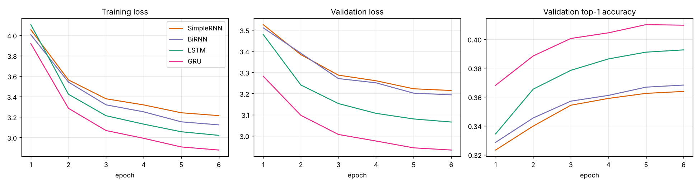
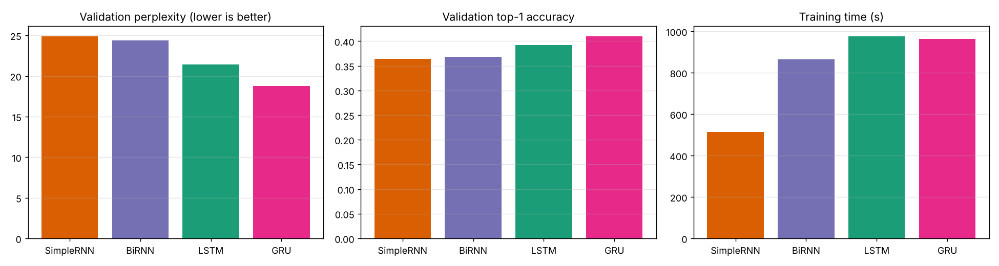
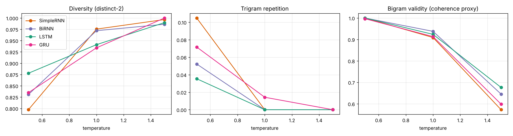

# Autoregressive word-level text generation on TinyStories

Assignment 2 for Foundations of Generative AI (ICT4403). The project trains four recurrent models (Simple RNN, Bidirectional RNN, LSTM and GRU) to predict the next word in short children's stories. It then uses each model to write new text from the same seed phrases at three sampling temperatures.

## Problem statement and objective

An autoregressive language model predicts the next word from the words before it. Feeding each predicted word back in as input lets the model write text one word at a time.

The objective is to build this system with four recurrent architectures under identical conditions, and to answer two questions:

1. Which architecture predicts the next word best, judged by loss, perplexity, accuracy and training time?
2. Which architecture writes the best text, judged by coherence, diversity, contextual consistency and repetition, and how does sampling temperature change that?

## Dataset

TinyStories (Eldan and Li, 2023, arXiv:2305.07759) is a collection of short stories written with a small vocabulary that a young child would understand. It was built to study how small language models learn to produce coherent English.

- Dataset page: https://huggingface.co/datasets/roneneldan/TinyStories
- File used: `TinyStoriesV2-GPT4-valid.txt` (about 22 MB), saved here as `data/input.txt`
- Download link: https://huggingface.co/datasets/roneneldan/TinyStories/resolve/main/TinyStoriesV2-GPT4-valid.txt

The full dataset has more than two million stories, which is too much for the CPU used here, so the project works with a subset. The file above contains 27,630 stories separated by an `<|endoftext|>` marker. A story averages 160 words (median 144, shortest 43, longest 810). The stories mostly use simple names (Tom, Lily, Sue), animals, toys and parks, and they contain a lot of quoted dialogue.

### Subset and split

The stories were shuffled with a fixed seed and then divided by story, so no story appears in more than one split.

| Split | Stories | Tokens | Windows |
|---|---|---|---|
| Training | 10,000 | 1,957,575 | 489,388 |
| Validation | 1,500 | 287,433 | 71,853 |
| Test | 1,500 | 292,039 | 73,004 |

The remaining 14,630 stories in the file were not used. Validation data chooses the best epoch for each model. The test split is touched only once per model, after that choice, to give an unbiased second measurement.

### Preprocessing

1. Split the file into stories at `<|endoftext|>`.
2. Replace curly quotes with straight ones and lowercase everything.
3. Tokenize with a regular expression. Words keep their internal apostrophes, so "don't" stays one token. The punctuation marks `. , ! ? ; : " -` are separate tokens, and paragraph breaks become `<nl>`. A `<eos>` token marks the end of each story. Other symbols are dropped.
4. Build the vocabulary from the training stories only: the 4,999 most frequent tokens plus `<unk>`. The training stories contain 7,867 distinct tokens, so about 2,900 rare ones become `<unk>`. That is 0.21% of training tokens and 0.34% of validation tokens. The generator never samples `<unk>`.
5. Build input-target pairs with a sliding window. The input is 24 consecutive tokens and the target is the token that follows. Training windows start every 4 tokens (stride 4) to cut training time. Neighbouring windows overlap almost completely, so little information is lost.

A model that always guessed the most common target word would score 8.2% top-1 accuracy on the validation set, which is the baseline the models need to beat.

## Models

All four models share one structure: an embedding layer (100 dimensions), dropout (0.2), one recurrent layer with 128 hidden units, dropout, and a linear layer that scores every word in the vocabulary. The output at the last time step feeds the linear layer.

| Model | Recurrent layer | Notes |
|---|---|---|
| Simple RNN | `nn.RNN` with tanh | Plain recurrence, no gates |
| BiRNN | `nn.RNN` with tanh, bidirectional | Forward and backward states are concatenated, so the output layer receives 256 values. The backward pass reads only the 24-word input window, never future words, so generation stays autoregressive. |
| LSTM | `nn.LSTM` | Input, forget and output gates plus a cell state |
| GRU | `nn.GRU` | Update and reset gates, no separate cell state |

### Comparable training conditions

| Setting | Value |
|---|---|
| Loss | Cross-entropy |
| Optimizer | Adam, learning rate 0.002, halved every 2 epochs |
| Batch size | 256 |
| Epochs | 6 |
| Gradient clipping | Norm 1.0 |
| Initialization seed | 42 for every model |
| Batch order | Identical for every model |
| Checkpoint | Weights from the epoch with the lowest validation loss |
| Hardware | 2 CPU cores, no GPU |

## Execution steps

```bash
git clone <this-repository-url>
cd tinystories-text-generation
pip install -r requirements.txt

# put the dataset at data/input.txt
mkdir -p data
curl -L -o data/input.txt https://huggingface.co/datasets/roneneldan/TinyStories/resolve/main/TinyStoriesV2-GPT4-valid.txt

python train.py --train_stories 10000
```

The full run took about 55 minutes of training on 2 CPU cores. A quick test that finishes in a couple of minutes: `python train.py --epochs 1 --train_stories 1500 --val_stories 300 --test_stories 300 --out results_test`. The notebook `tinystories_generation.ipynb` runs the same script and displays the saved results.

Dependencies: Python 3.9 or later, `torch`, `numpy`, `matplotlib`.

```
train.py                        data preparation, models, training, evaluation, generation
tinystories_generation.ipynb    notebook wrapper that runs the script and shows results
requirements.txt
data/input.txt                  TinyStories validation file (download it, see above)
train_log.txt                   console log of the full run
results/
  metrics.json                  validation and test metrics, parameter counts, training times
  history.csv                   per-epoch losses and accuracies
  generation_metrics.json       text metrics per model, seed and temperature
  generation_summary.json       the same, averaged over seeds
  generated_samples.md          all generated text
  training_curves.png
  model_comparison.png
  temperature_effects.png
  *.pt                          saved weights
```

## Results

### Prediction quality

| Model | Parameters | Val loss | Val perplexity | Val top-1 | Val top-5 | Test perplexity | Test top-1 | Training time (6 epochs) |
|---|---|---|---|---|---|---|---|---|
| Simple RNN | 1,174,440 | 3.214 | 24.9 | 36.4% | 62.1% | 25.4 | 36.1% | 514 s |
| BiRNN | 1,843,880 | 3.194 | 24.4 | 36.8% | 62.6% | 24.9 | 36.6% | 865 s |
| LSTM | 1,262,760 | 3.065 | 21.4 | 39.3% | 64.4% | 21.7 | 39.1% | 976 s |
| GRU | 1,233,320 | 2.933 | 18.8 | 41.0% | 66.5% | 19.2 | 40.8% | 963 s |

Perplexity is the exponential of the cross-entropy loss. A value of 18.8 means the GRU is about as uncertain as if it were choosing among 19 equally likely words at each step. Every model is far above the 8.2% top-1 baseline.





## Model comparison and evaluation

Quantitative results:

- The GRU is best on every prediction metric, on both the validation and the test split. It leads the LSTM by 2.7 perplexity points and 1.7 points of top-1 accuracy, and it leads the Simple RNN by 6.1 perplexity points and 4.6 points of accuracy.
- The two gated models clearly beat the two ungated ones. The LSTM is about 3 perplexity points better than the Simple RNN and the BiRNN.
- The BiRNN gains very little over the Simple RNN (0.5 perplexity points, 0.4 points of top-1) while using 57% more parameters and 68% more training time. Its backward pass reads the same 24-word window the forward pass already sees, and the word to be predicted lies outside that window, so the extra direction has little to add.
- Validation and test numbers agree to within 0.6 perplexity points for every model, and the ranking is the same on both. The best epoch was the last one (epoch 6) for all four models, and the curves were still falling slowly, so more epochs would improve every model.
- The Simple RNN trained fastest at 86 s per epoch. The BiRNN, LSTM and GRU took 144 to 163 s per epoch. The timings come from a shared 2-core CPU, so only the gap between the Simple RNN and the rest is large enough to trust.
- The GRU's lead shows up in the first epoch (validation top-1 of 36.8% after one epoch, against 32.3% to 33.4% for the others), which suggests it learns faster as well as ending higher.

Qualitative observations, from reading the 60 generated passages in `results/generated_samples.md`:

- All four models reproduce the style of the data: stories open with "once upon a time" or "one day", characters have short first names, sentences are short, and dialogue appears in quotation marks. Nine of the 60 passages reach the end-of-story marker and then start a new story, so the models have learned where stories finish.
- At low temperature the sentences are grammatical but the stories do not hold together. A SimpleRNN sample begins "once upon a time, there was a little girl named lily. she loved to play with his ball in the park", switching from "she" to "his" within one sentence. A GRU sample on the seed "the dog was very happy because" turns into "the cat looked at the cat, but the dog was too scared", so the characters get mixed up.
- A 24-word context window cannot carry a plot. Each sentence follows plausibly from the one before, and nothing connects the beginning of a passage to its end.

## Sampling temperature analysis

Each model wrote 60 words from each of five seeds at temperatures 0.5, 1.0 and 1.5. The five seeds are "once upon a time, there was a little girl named", "one day, a boy named tom went to the park and", "the dog was very happy because", "she looked at the big red ball and said,", and "mom and dad took the family to the". The random stream was identical across models for each seed. Temperature divides the logits before the softmax: values below 1 sharpen the distribution toward likely words and values above 1 flatten it.

The text metrics, averaged over the five seeds:

- Distinct-2: share of two-word pairs in a passage that are unique (higher means more diverse).
- Trigram repetition: share of three-word sequences that repeat an earlier one (lower is better).
- Bigram validity: share of adjacent word pairs that also occur in the training stories. This is a rough coherence proxy. It checks local word order, not meaning.

| Model | Temp | Distinct-2 | Trigram repetition | Bigram validity |
|---|---|---|---|---|
| Simple RNN | 0.5 | 0.797 | 0.105 | 1.000 |
| Simple RNN | 1.0 | 0.975 | 0.000 | 0.909 |
| Simple RNN | 1.5 | 0.997 | 0.000 | 0.572 |
| BiRNN | 0.5 | 0.831 | 0.052 | 1.000 |
| BiRNN | 1.0 | 0.972 | 0.000 | 0.938 |
| BiRNN | 1.5 | 0.986 | 0.000 | 0.645 |
| LSTM | 0.5 | 0.878 | 0.035 | 1.000 |
| LSTM | 1.0 | 0.941 | 0.000 | 0.924 |
| LSTM | 1.5 | 0.990 | 0.000 | 0.676 |
| GRU | 0.5 | 0.835 | 0.072 | 0.997 |
| GRU | 1.0 | 0.934 | 0.014 | 0.913 |
| GRU | 1.5 | 1.000 | 0.000 | 0.598 |



Temperature 0.5. The text is fluent and reads like a real children's story: "sue loved to play with her toys in her room. one day, she wanted to make her toy car." It is also the most repetitive and least diverse setting. Phrases such as "the bird was very happy" and "a big tree" come back again and again, and 3.5 to 10.5% of three-word sequences are repeats, depending on the model. Every model scored close to 1.0 on bigram validity here, so that metric cannot separate the models at this temperature.

Temperature 1.0. Repetition almost disappears (only the GRU has any, at 1.4%) and diversity rises to between 0.93 and 0.98. The sentences keep their shape, but odd word combinations appear: "she had a big room of white ambulance in the park every day". Bigram validity falls by 6 to 9 points, which understates the damage a reader sees, since word pairs can be valid while the sentence is not.

Temperature 1.5. Diversity is at its maximum and the text turns into unrelated words and invented-sounding names: "kitty had lots of different yarn together because everything said, milo showed it to surprise what harsh keeper". Bigram validity drops by another 25 to 34 points, to 57 to 68%. No model produces a usable story at this setting.

Raising temperature trades coherence for diversity, and the trade gets steeper as temperature goes up. The change between 1.0 and 1.5 is much larger than the change between 0.5 and 1.0. Differences between the architectures are smaller than the differences between temperatures. At 0.5 the LSTM was the least repetitive (3.5% repeated trigrams) and the most diverse (distinct-2 of 0.878), while the Simple RNN was the most repetitive (10.5%). At 1.0 the BiRNN kept the most valid word pairs (0.938). These gaps come from five seeds per cell and should be read as hints.

## Conclusion

The GRU is the best predictor on this dataset. It has the lowest validation perplexity (18.8) and the highest top-1 (41.0%) and top-5 (66.5%) accuracy, the ranking holds on the held-out test split, and the margin is large enough to trust even though each model was trained once. It also trains at the same cost as the LSTM. The gated models are clearly better than the plain and bidirectional RNNs, and the bidirectional layer adds cost with almost no benefit for next-word prediction.

For text quality the picture is less one-sided. The GRU gives the best predictions, but at temperature 0.5 the LSTM repeated itself least and used the widest range of words. Temperature 1.0 gives the best balance of the three settings tested. At 0.5 the stories read well but repeat themselves, and at 1.5 they fall apart. A value between 0.5 and 1.0 might be better still, but it was not tested.

## Limitations

- The project uses 10,000 of the 27,630 stories in the validation file, and only a small share of the full TinyStories collection. Training on more data, or for more epochs, would improve every model, since validation loss was still falling at epoch 6.
- Training windows start every 4 tokens rather than every token, to fit the time budget on 2 CPU cores.
- Each model was trained once with one random seed, so small differences (for example between the Simple RNN and the BiRNN) could change with another seed.
- The generation metrics use five seeds and 60 words per passage. Bigram validity measures local word order only. It reaches 1.0 at temperature 0.5 and so cannot rank models there.
- The 24-word context window means the models cannot keep a plot or a character's identity across a story.
- Timing was measured on a shared CPU, so small differences are unreliable.
- Hyperparameters (hidden size, window length, epochs, learning rate) were fixed in advance and not tuned for each model.
